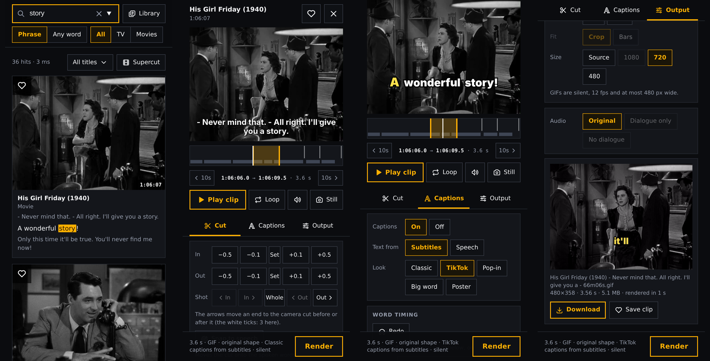
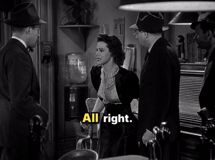
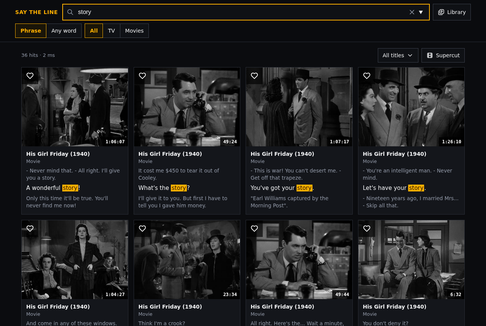
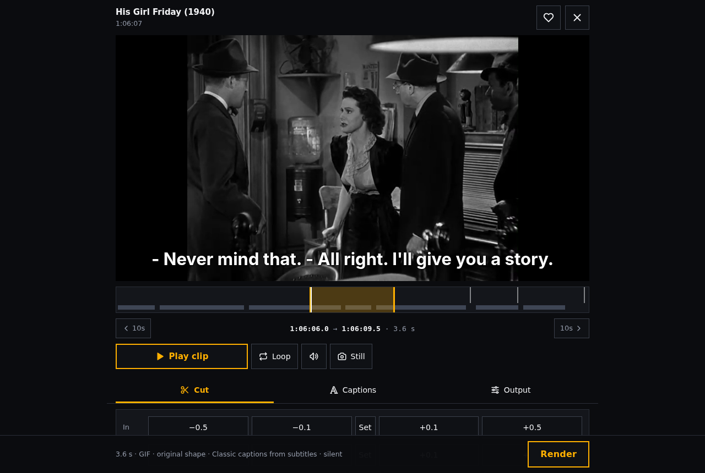

# Say the Line

**Search everything ever said in your Jellyfin library, then cut it into a clip, a GIF, a still
or a supercut, or make it say a sentence of your own, from your phone.**

Say the Line indexes the subtitles of your movies and episodes. Type a line ("we need to talk") and you
get every scene where it's said, with thumbnails. Tap one to open a small editor: trim the cut,
snap it onto the spoken words, add captions (plain subtitles, or TikTok-style word-by-word
looks), pick a shape (16:9, 9:16, 1:1…) and render. Or join every hit into one supercut, read a
title's whole script, or type a sentence and have your library say it, a word or phrase per clip.

It runs on the machine that has your media, next to Jellyfin, and is used from a browser.



<p align="center"></p>

<details>
<summary>On a desktop</summary>




</details>

<sub>Screenshots use *His Girl Friday* (1940), which is in the public domain.</sub>

## Features

- **Search**: phrase or any-word search across every subtitle line (SQLite FTS5, a few ms). Exact
  matches first, then close ones (the words a few apart); `"quotes"` for exactly those words,
  `-word` to leave lines out, `word*` for any word starting so. "doin" also finds "doing";
  filter by TV / movies / show, with the lines before and after each hit and recent searches.
  A show or movie's name brings up the title itself first (All / Titles / Lines to filter).
- **Scripts**: open a title (a show goes season → episode) to read its subtitles in order, under its poster from Jellyfin, with a frame from the scene every couple of minutes. Find
  in the page with ▲▼ through the matches and marks on the scrollbar; tap a line, or a first and
  last line, to clip it. ‹ › step to the episode before or after.
- **Editor**: preview window, drag-to-trim timeline, ±0.1 s nudges, play / pause / loop / mute,
  line list (clip just this line, grow, trim), editable caption text.
- **Clean edges**: a new clip never opens or closes on half of the line before or after it, and it
  starts on the line's own shot and ends before the next one (no half-second of another scene).
- **Camera cuts**: marked on the timeline; the trim handles stick to them, the arrow buttons jump
  an end to the next cut, *Whole* takes the entire shot. Frame-exact.
- **Snap to speech**: listens to the cut (faster-whisper) and moves it onto the spoken words.
  It also finds subtitles that run seconds early or late, and remembers that per episode.
- **Captions**: burned in with libass. Classic subtitles, or word-synced looks: **TikTok**,
  **Pop-in**, **Big word**, **Poster** (automatic expressive typography sized by part of
  speech), **Kinetic** (Poster in motion: justified stacks with a vertical word locked up beside
  them, words that rise, slam or slide in, cards that push in and fall away) and **Intense**
  (Kinetic with everything: words that also drop, wipe or type themselves in, a highlight bar behind
  the key word, cards that fall, lift or scatter away). Poster and Intense size words by how loudly they are said:
  shouts land big, whispers are drawn in outline. Text from the subtitles or from speech-to-text, editable before rendering, and
  movable earlier or later for subtitles that run early or late.
  Five sizes (XS to XL, a 4x range) and five positions (Top, Upper, Middle, Lower, Bottom).
- **Output**: MP4, WebM, GIF or a **still** (JPEG); original / 16:9 / 4:3 / 1:1 / 9:16 with
  crop or bars (drag the crop frame on the picture to choose what stays in, a corner or pinch to
  zoom in); 480–1080 or source size.
- **Audio** (optional): *Dialogue only* or *No dialogue* via demucs stem separation.
- **Slow motion and 60 fps** (optional, Cut > Interpolation): mark part of a clip (up to 5 s) to play at ½× or ¼×. The missing
  frames are made by [RIFE](https://github.com/nihui/rife-ncnn-vulkan) on the GPU, so it stays smooth,
  and each camera shot is slowed on its own so shots never blend. Sound pitched down, stretched at the
  same pitch, or silent; captions follow the slowed picture. The editor previews it at the slower speed.
  **60 fps** (same Interpolation section) does the same for the whole clip at normal speed: smooth
  motion from a 24 or 30 fps source. **Preview** renders just that part small, in a few seconds, to
  check the motion before the real render.
- **Studio**: put any saved clips together, from any mix of shows and movies, in your own order.
  Add them from the Library (by tag), reorder, nudge each start and end, preview each clip in place,
  then render one video with one caption look and shape. Each clip keeps its own cut, caption edits
  and slow motion from the editor (the scissors on a clip open it there, and the changes come back
  to the Studio). Saved as a draft like the rest; **New** starts another cut and
  keeps the current one under Drafts. A rendered Studio cut opens again in the Studio (Library →
  Open in Studio) as a new draft with its clips, song and settings; the render stays as it is.
  **Music**: upload a song to go under it. Its tempo and beats are found on upload (tap or type to
  correct the BPM); the song dips whenever someone speaks, and each join can land on the beat or the
  bar. Play all plays the song with the clips before you render.
  **Speed ramp**: the picture speeds up on every beat (or bar) and slows between, easing along a
  smooth or sharp curve, with the slow stretches made smooth by RIFE: Subtle (1.8x to 0.55x), Strong
  (3.5x to 0.3x) or Extreme (6x to 0.15x). Each beat averages normal speed, so the cut keeps its
  length. The peak lands just before each beat by default (motion reads a little late, so that
  feels on it), or earlier, or right on it. Spoken lines can stay at normal speed with their sound (the ramp runs between them, timed
  from the words actually said) or be ramped too, under the song alone. Play all previews it.
  A preview window at the top plays any clip (or Play all) in the cut's shape; under the Timeline a
  ribbon of thumbnails shows the clips in order: tap one to pick it (its controls show below), tap
  again to play it.
  **Timeline**: the cut end to end with the song's beats and a playhead. The speed ramp is an effect on it: purple
  stretches you drag by their ends or middle (snapping to the beat), or nudge a beat at a time, so it
  runs on only part of the cut; outside them the clips play as they are, with their sound.
  **Film sound: Dialogue only** strips the films' own music and effects from the whole cut (demucs).
- **Time left**: every wait (renders, slow motion, listening, supercuts, Studio) shows how far along
  it is and about how long is left, from the job's own progress and how long the same kind of job
  took before (`data/eta.json`); a job waiting its turn shows how long until it starts.
- **Timing log**: every request and job step is timed into `data/perf.jsonl` (capped at about 20 MB),
  with whether a cache already had it; `GET /api/perf` (or `python -m saytheline.perf`) sums it up:
  the slowest routes, repeats a cache could have saved, cache hit rates, and each job's steps.
- **Supercut**: every hit for a search in one video. It checks each hit against the audio,
  skips lines that are never actually heard, can cut to just the phrase, trims each clip to its
  shot, hides repeats, evens out loudness and adds labels and captions. Each clip previews in its
  own thumbnail.
- **Say Anything**: type a sentence and the library says it. Each word or phrase (longest first)
  comes from a line where it's really heard, cut on measured silence. Swap any piece for another
  take with ‹ ›, trim either edge, preview pieces in place while others are still listening, and
  render with captions that build the sentence up or pop in word by word. A word nobody says is
  marked with the reason.
- **Library**: heart moments and clips, tag them for projects; every edited clip is kept as a
  draft (Library → Recent edits) with its captions, transcript and settings. Heart a supercut or Say
  Anything that isn't rendered yet to keep it under Library → Drafts and finish it later.
  **Start fresh** on a saved moment goes back to the plain line without touching the saved version;
  tap the heart to save the new one over it.

## What you need

- **Jellyfin** with your media (10.10+; tested on 10.11).
- **The media files readable** from the machine running Say the Line (same box, or a mounted share).
- **Subtitles**: external `.srt/.ass/.vtt` files next to the videos and/or embedded *text* tracks.
  Blu-ray and DVD picture subtitles (PGS, VobSub) are read by OCR when **tesseract** is installed
  (`apt install tesseract-ocr tesseract-ocr-eng`, `brew install tesseract`, on Windows
  `winget install UB-Mannheim.TesseractOCR`): only when a title has
  no English text track, about 30 s a film, kept in `data/ocr` so each is read once, and at most an
  hour of it per index pass (`--ocr-minutes`).
  Bazarr is the easy way to fill the other gaps.
- **Python 3.11+** and **ffmpeg** built with libass (most distro and Homebrew builds are).
- About 2 GB of disk for the speech model and Python packages. A modern 4-core CPU is plenty;
  no GPU needed.
- Optional, for slow motion: [rife-ncnn-vulkan](https://github.com/nihui/rife-ncnn-vulkan/releases)
  and a GPU with Vulkan (integrated is fine: about 13 s to slow 2 s to 4× at 480p on a Radeon 680M).
  Unzip it, keep its `rife-v4.6` model folder beside the binary, and set `[tools] rife` to the binary
  (or put it on PATH). On a fast GPU, `[tools] rife_threads = "8:8:8"` keeps it fed.
- Optional, an **Nvidia GPU** can also take speech, *Dialogue only* and video encoding off the CPU
  (`stt_device`, `demucs_device`, `encoder` in [`saytheline.example.toml`](saytheline.example.toml));
  [docs/windows.md](docs/windows.md#nvidia-gpu) has the setup and measured gains.

### Platforms

| | Status |
|---|---|
| **Linux** | Native, the main target. VAAPI hardware previews are used when present. |
| **macOS** | Native should work (`brew install ffmpeg python`); previews encode on the CPU. Not yet tested. |
| **Windows** | Native works (tested on Windows 11 with an Nvidia GPU): see **[docs/windows.md](docs/windows.md)**. Docker Desktop or WSL2 are the other way. |
| **Docker** | `compose.yaml` included: one container, media mounted read-only. |

## Quick start (native)

```bash
git clone https://github.com/alex-colleran/say-the-line && cd say-the-line
python3 -m venv .venv && . .venv/bin/activate
pip install -r requirements.txt
python -m spacy download en_core_web_sm        # for the Poster caption look
cp saytheline.example.toml saytheline.toml       # then edit it (see below)
python -m saytheline doctor                    # checks everything, says what to fix
python -m saytheline index                     # TV episodes (add --movies for films)
python -m saytheline serve                     # http://127.0.0.1:8765/
```

On Windows (PowerShell) the same steps are `py -m venv .venv`, `.venv\Scripts\Activate.ps1` and
`Copy-Item` for `cp`; [docs/windows.md](docs/windows.md) walks through it.

### Configure (`saytheline.toml`)

The minimum is how to reach Jellyfin and, if Jellyfin sees your files under different paths
(Docker), how to translate them:

```toml
[jellyfin]
url = "http://localhost:8096"
api_key = "…"            # Jellyfin Dashboard → API Keys → +
path_map = { "/media" = "/srv/media" }   # Jellyfin's path = this machine's path
```

No easy way to copy a key onto this machine? Set `url`, then `python -m saytheline login`: it shows
a Quick Connect code to approve in any signed-in Jellyfin app and saves the token as `api_key`.

The DB source (`db = ...`) is what the author runs day to day; the API source has been used
against a live Jellyfin 10.11 (from Windows, over the network), so please report anything odd.

Every setting can also be an environment variable (`SAYTHELINE_JELLYFIN_URL`, …); see
[`saytheline.example.toml`](saytheline.example.toml) for all of them.

### Indexing

```bash
python -m saytheline index --series "Your Show"    # one show first, to try it
python -m saytheline index                          # all episodes
python -m saytheline index --movies                 # all movies
python -m saytheline search "we need to talk"          # search from the terminal
```

External subtitle files index fast: thousands of episodes in a couple of minutes. Embedded
tracks mean reading through each video file, so a big library takes hours the first time. It is
incremental, so later runs only pick up new or changed subtitles, and it works newest first. Run it nightly (cron, a
systemd timer: see `deploy/`).

## Docker

```bash
cp saytheline.example.toml saytheline.toml   # set url/api_key; path_map to the /media mount below
docker compose up -d --build
docker compose exec say-the-line python -m saytheline doctor
docker compose exec say-the-line python -m saytheline index
```

Edit the media volume in `compose.yaml` so the container sees your library (read-only). If
Jellyfin itself runs in Docker, mounting the same host folder at the same path as Jellyfin's
container means no `path_map` is needed.

## Security

There is **no login**. By default Say the Line listens on `127.0.0.1` only. To use it from a phone,
put it on a private network (for example **Tailscale**: `tailscale serve --bg 8765`) or behind a
reverse proxy with authentication. **Don't expose it to the internet**: anyone who can reach it
can browse your library and start heavy video jobs.

Say the Line only *reads* your media and Jellyfin. Everything it writes (index, previews, clips,
library) goes into the data folder (`./data` by default).

## How it works (short)

- `python -m saytheline index` asks Jellyfin for every item and its subtitle tracks, picks the best English
  dialogue track per item, and stores every line in a SQLite FTS5 index.
- The web server (Python standard library only) serves the single-page UI and runs ffmpeg for
  previews, thumbnails and renders, one heavy job at a time.
- Speech features run faster-whisper (`small.en`, CPU) in a child process. Word starts are
  refined against the audio energy so captions never appear before the word is said.

More detail, including design decisions and their reasons, is in [`docs/how-it-works.md`](docs/how-it-works.md).

## For AI agents: the MCP server

`python -m saytheline mcp` gives an agent (Claude Code, Claude Desktop, …) tools to search your
library, read a title's script, look at candidate frames, make GIFs / clips / stills / supercuts
and Say Anything sentences, and refine them from
your feedback ("start earlier, bigger text"). Ask it to "reply with a reaction GIF from my
library" and it can. Setup and design: [`docs/mcp.md`](docs/mcp.md).

```bash
pip install -r requirements-mcp.txt
claude mcp add -s user say-the-line -- "$(which python)" -m saytheline mcp   # run from the repo folder
```

## Using it with an AI coding agent

[`AGENTS.md`](AGENTS.md) (also read by Claude Code via `CLAUDE.md`) describes the layout, how to
run and test it, and the rules to follow when changing it. Point your agent at it before asking
it to set Say the Line up or change it.

## Similar projects

Plenty of people have had this idea. If Say the Line isn't quite what you want, one of these might
be. It shares no code with any of them.

- [videogrep](https://github.com/antiboredom/videogrep) by Sam Lavigne was the first: search a
  video's subtitles and cut the matches into a supercut (command line).
- [Frinkiac](https://frinkiac.com/) is the classic quote-to-screenshot search, for The Simpsons
  (hosted, not self-hosted).
- [jellymeme](https://github.com/armanckeser/jellymeme): describe a scene in your Jellyfin
  library in your own words and get it as a captioned GIF, clip or still, or a montage.
- [CineSnip](https://github.com/jayhosted/CineSnip): a Discord bot that makes GIFs and clips from
  Plex or Jellyfin by quote or timecode.
- [jelly-clipper](https://github.com/arnolicious/jelly-clipper): make and share clips of Jellyfin
  content, Twitch-clip style.
- [Cliparr](https://github.com/TechSquidTV/Cliparr): a timeline clip editor for Plex, Jellyfin
  and local files, with GIF export and styled subtitles.
- [GifHorse](https://github.com/Coyote-git/gifhorse): search the dialogue of your video files and
  make subtitled GIFs from the command line.
- [PlexGifMaker](https://github.com/TechBuckler/PlexGifMaker): captioned GIFs from a Plex library.
- [quote-clipper](https://github.com/victornpb/quote-clipper) and
  [Quote2Clip](https://github.com/Franckevicius/Quote2Clip): command-line quote compilations.

What Say the Line adds to the mix: exact search across the whole library with the lines around each
hit, cuts that land on the shot changes so no stray frames from the next scene slip in, snapping
a cut onto the spoken words (which also spots out-of-sync subtitles), word-by-word caption
looks, supercuts that check each line is really said, Say Anything (sentence mixing from takes
that are listened to, not guessed from subtitle timing), and an MCP server so an AI agent can make
clips for you.

## Personal use

Say the Line is a tool for working with media you own, on your own machine. Respect the rights of
whoever made the films and shows when you share what you cut.

## Licence

MIT, see [LICENSE](LICENSE). The bundled caption fonts keep their own open licences
([`saytheline/fonts/licenses`](saytheline/fonts/licenses)), and the interface icons are
[Tabler Icons](https://tabler.io/icons) (MIT).
